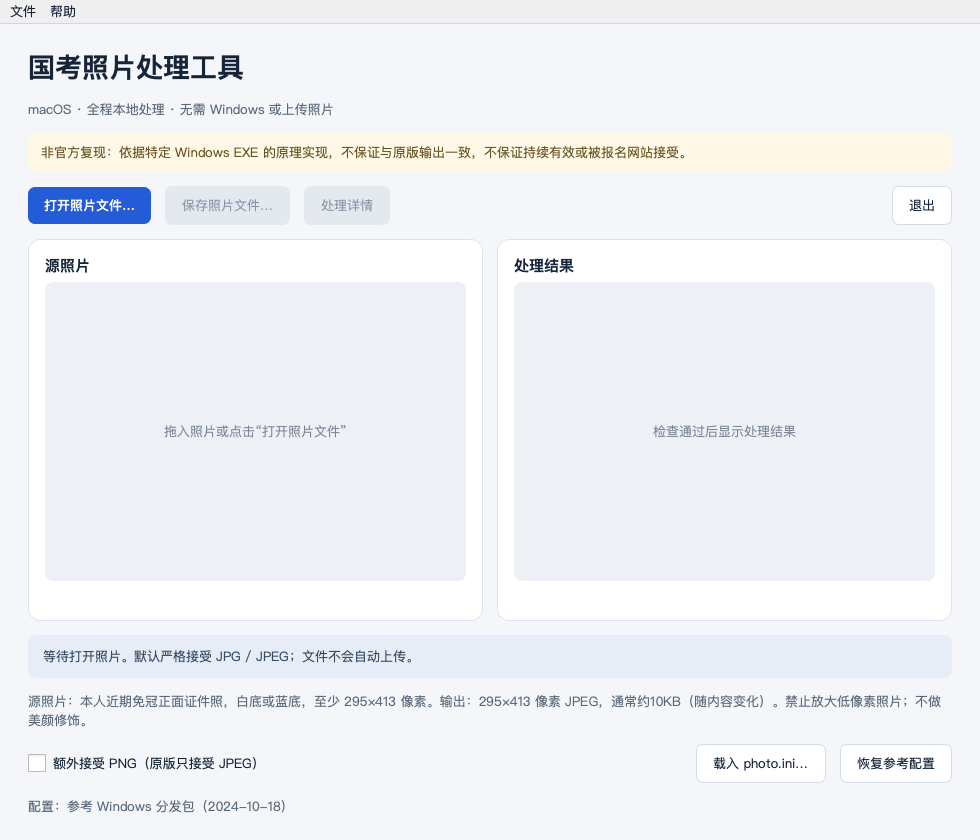

# 国考照片处理工具 macOS 版

[](https://github.com/shoal-rat/gwy-photo-mac/actions/workflows/ci.yml)
[](LICENSE)

在 Mac 上完成“打开照片 → 自动检查 → 预览 → 保存报名照片”，无需安装 Windows、Wine，也不需要把证件照上传到第三方网站。提供桌面应用和命令行工具。

> **这是非官方开源复现，不是官方发布的 Mac 版。** 项目依据一份 Windows `照片处理工具.exe` 的处理原理实现，**不保证与 EXE 输出完全一致，不保证持续有效，不保证被任何年度、考区或报名网站接受**。官方工具、照片要求或服务端校验可能发生变化，最终以当次官方要求及报名网站结果为准。



## 下载与使用

到 **[Releases 下载 macOS 应用](https://github.com/shoal-rat/gwy-photo-mac/releases/latest)**：

- Apple 芯片（M1/M2/M3/M4 等）选择 `macOS-arm64.zip`。
- Intel 芯片选择 `macOS-x86_64.zip`。
- 解压后把 `GwyPhotoMac.app` 拖到“应用程序”，再打开。应用包含 Python 与图像处理依赖，无需另装运行环境。
- 建议使用 macOS 13 或更新版本。发布页说明具体构建和验证环境；没有提供通用二进制，同一应用包不能同时代表两种架构都经过实机验证。

应用采用 ad-hoc 签名，没有 Apple Developer ID 签名或公证。macOS 可能拦截首次启动：确认下载来源及 SHA-256 后，按系统提示在“系统设置 → 隐私与安全性”中允许该应用打开。不要关闭系统整体安全检查。也可以使用下方源码安装方式。

1. 点击“打开照片文件”，或拖入一张照片。
2. 检查通过后，查看原图和输出预览。
3. 点击“保存照片文件”，默认文件名为 `报名照片.JPG`。源图不会被覆盖。
4. 上传保存的 JPG。不要再用聊天软件、图片编辑器或压缩工具另存，文件尾信息可能因此丢失。

**默认源图要求**：本人近期免冠正面证件照，白底或蓝底，JPG/JPEG，宽度至少 295、高度至少 413 像素。禁止通过放大小图凑够像素；不做美颜、磨皮、换底或五官修改。参考官方说明见[2027 年报考指南“照片处理工具”条目](https://shanghai.chinatax.gov.cn/xxgk/rsxx/202610/t481764.html)，使用时仍须核对当次要求。

默认输出为 **295×413 像素、RGB JPEG、质量参数 40，附参考工具的文件尾标记**。文件一般约 10KB，实际大小随照片内容变化；没有为凑固定大小而填充数据。

## 与 EXE 版的对应范围

| 环节 | 本项目行为 |
| --- | --- |
| 打开与格式检查 | 按文件内容检查 JPEG；支持 `.jpg/.jpeg/.jpe/.jfif` 文件选择 |
| 源图像素检查 | 不足参考配置的宽或高即拒绝，不先放大 |
| 背景检查 | 复现三处 3×3 采样及 HSI 白/蓝背景分类，三处类别须一致 |
| 人脸检测 | 附带参考包同一份 Haar XML；倍率 1.1、邻居 2、最小 30×30，取最宽的人脸 |
| 人像比例与裁切 | 复现 0.32 占比阈值、裁切常数、边界夹取及左右/顶部留白检查 |
| 缩放与编码 | 双线性缩放；JPEG 质量 40；附加分析到的十字节文件尾信息 |
| 预览与保存 | 原图/成品预览；检查失败禁用保存；保存成功后可退出 |
| 配置 | 内置参考分发包 `photo.ini` 参数，可载入自己的 `[PhotoInfo]` 配置 |

这里的“检查通过”只表示本地复现的技术检查通过，**不代表官方网站审核通过**。背景检测是局部颜色采样，不是全图抠图；人脸检测不能证明照片属于使用者，也不能判断照片是否近期拍摄。参考程序会取最大人脸，本项目保留该行为，不能用作多人照片审查器。

额外提供的 **PNG 转换选项、拖放、方向信息处理、详情报告、命令行和原图防覆盖** 属于本项目扩展。PNG 默认关闭；启用后仅接受不透明 PNG，并按同一套检查继续处理。透明图不自动补白。程序会应用 EXIF 方向并在输出中移除原图 EXIF；这可能与旧版 Windows 解码器行为不同。

OpenCV 1.0 与现代 OpenCV 4.11 的检测结果、Pillow 与原 CxImage/libjpeg 的编码结果可能不同。即使参数相同，也不能据此宣称位级等价。文件尾标记只是复现到的静态格式信息，**不是官方数字签名、审核凭证或长期兼容保证**。

## 从源码安装

需要 Python 3.10–3.14。以下命令只在首次安装时下载依赖，实际照片处理完全离线。

```bash
git clone https://github.com/shoal-rat/gwy-photo-mac.git
cd gwy-photo-mac
python3 -m venv .venv
source .venv/bin/activate
python -m pip install -e '.[gui]'
gwy-photo-gui
```

只使用命令行时执行 `python -m pip install -e .`，不需要 Qt。

```bash
# 严格 JPEG 输入；中文路径可直接使用
gwy-photo process '证件照.jpg' -o '报名照片.JPG'

# 显式接受不透明 PNG
gwy-photo process '证件照.png' --allow-png -o '报名照片.JPG'

# 使用自己下载的原工具配置，向标准输出写入不含文件路径的报告
gwy-photo process '证件照.jpg' --config 'photo.ini' -o '报名照片.JPG' --json

# 目标已存在时默认拒绝；仅显式加 --overwrite 才允许替换，仍禁止覆盖源图
gwy-photo process '证件照.jpg' -o '报名照片.JPG' --overwrite
```

成功退出码为 `0`，检查或保存失败为 `2`。`python -m gwy_photo_mac` 与 `gwy-photo` 等价。应用包也保留命令行入口：

```bash
'/Applications/GwyPhotoMac.app/Contents/MacOS/GwyPhotoMac' --cli process '证件照.jpg' -o '报名照片.JPG'
```

配置缺省值有两层含义：**不指定配置**时使用随参考工具分发包附带的四项参数；**指定自己的 INI**时，缺少的键使用 EXE 内置默认值。两者并不完全相同，详见[逆向与兼容性说明](docs/REVERSE_ENGINEERING.md)。改配置不能自动适配未知的新版本服务端规则。

## 隐私与开源边界

- 处理代码没有网络请求、照片上传、遥测、账号或后台更新功能。
- 只在选择的保存位置写入成品。GUI 不自动写日志或临时照片；CLI 的 JSON 报告只输出到终端，是否重定向保存由使用者决定。
- 报告不包含源文件名或绝对路径，但包含人脸框、颜色采样和处理参数，分享前仍应自行检查。
- 仓库不含真实证件照、个人材料、Windows EXE/DLL 或原版界面素材。截图是空白启动界面；测试使用合成像素和模拟检测结果，另有真实分类器的负例测试。
- 新增代码采用 MIT；Haar 模型保留 Intel 原始许可，运行依赖使用各自许可，见 [THIRD_PARTY_NOTICES.md](THIRD_PARTY_NOTICES.md)。

## 开发、验证与打包

```bash
python -m pip install -e '.[gui,dev,bundle]'
ruff check .
QT_QPA_PLATFORM=offscreen pytest -q
python -m build

# 必须在 macOS 上构建；使用当前 Python 的架构
python scripts/build_macos.py
```

打包脚本会生成 `dist/GwyPhotoMac.app`、ZIP 和 SHA-256 文件，收集依赖许可证，然后验证模型载入、JPEG 编码、Qt 窗口启动、命令行入口及 ad-hoc 签名。GitHub Actions 分别在 Apple Silicon 和 Intel runner 上测试和构建；推送 `v*` 标签后自动附带兼容性说明发布 Release。

参考 EXE 机器码的可选差异测试：

```bash
python -m pip install pefile unicorn
python scripts/check_reference.py '/path/to/照片处理工具.exe'
```

此脚本只接受文档记录的 SHA-256，在隔离的 x86 内存模拟器中执行背景分类及裁切数值片段，不启动 Windows 程序，不载入其 DLL，也不上传文件。它验证的是已识别数值逻辑，不是完整 Windows GUI 或官网验收。

## 失效、反馈与维护

若官网拒绝成品，请优先使用当次官方工具和受支持的 Windows 环境，避免影响报名。欢迎提交 Issue，说明工具版本/下载日期、macOS/芯片、失败信息和**去除个人内容**的报告；请勿公开证件照、身份证号、报名号或账号信息。

新版本适配需要重新确认原工具参数、检测和文件格式，并补充差异测试；没有“改一个标记就永远有效”的承诺。项目按现状提供，不提供报名成功、持续可用或官方认可的保证。

相关资料：[逆向记录与功能差异](docs/REVERSE_ENGINEERING.md) · [贡献指南](CONTRIBUTING.md) · [更新记录](CHANGELOG.md)
